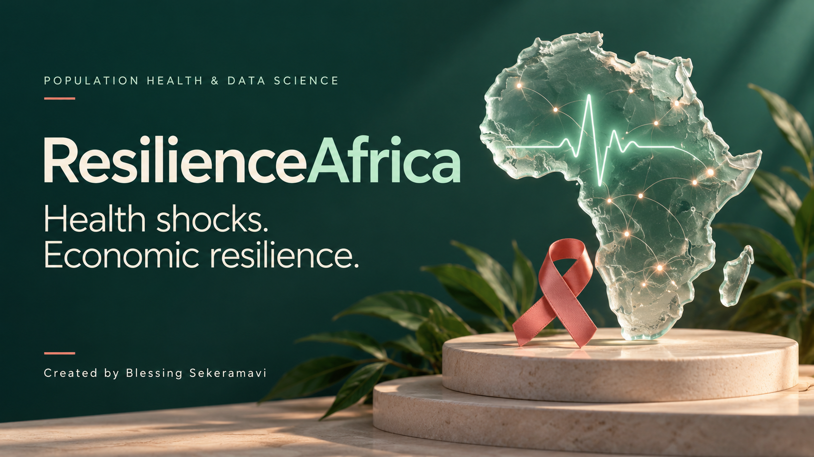
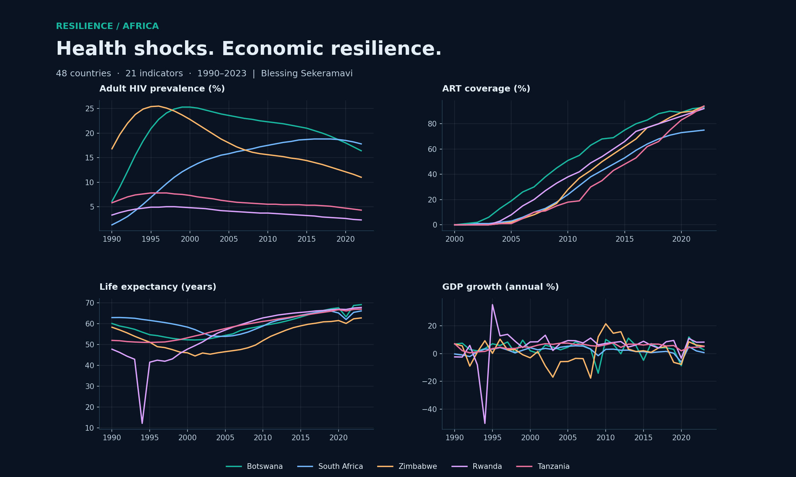

# ResilienceAfrica
### HIV/AIDS, health systems and economic development in Sub-Saharan Africa
**Created by Blessing Sekeramavi**

[**Open the live interactive report →**](https://sn8qwviwero3futjtggbwg.streamlit.app/)

[](https://sn8qwviwero3futjtggbwg.streamlit.app/)\n\n*Cover: AI-generated conceptual illustration.*\n\n[**Read the original master’s thesis (PDF)**](reports/Blessing_Sekeramavi_Thesis.pdf)\n\n

An interactive research report built from the actual dataset recovered from my master's thesis Power BI dashboard: **48 countries · 21 indicators · 21,302 observations · 1990–2023**.

Read the complete project report from introduction to conclusion, then explore country trajectories, HIV prevalence, ART coverage, life expectancy, GDP growth and other development indicators. View an Africa choropleth, compare matched country-year observations and download data.

## Power BI support
The Power BI tab includes working interactive recreations of all analytical chart types from the original dashboard, the original PBIX download and structured country lookup. Three original pages use R visuals, which cannot be publicly embedded through Power BI Publish to web. An optional published Power BI iframe can be configured separately; no live Power BI URL has been supplied. [Power BI integration guide](powerbi/README.md).

## Run locally
```bash
python -m pip install -r requirements.txt
streamlit run app.py
```

## Read the research
[Original thesis (PDF)](reports/Blessing_Sekeramavi_Thesis.pdf) · [Research report](reports/REPORT.md) · [Recovered dataset](data/thesis_data.csv) · [Indicator dictionary](data/indicator_dictionary.csv) · [Data provenance](data/provenance.json)

## Reproduce the analysis
```bash
python scripts/analyze.py
```
Outputs include pooled OLS and country fixed-effects models with country-clustered standard errors, plus indicator coverage. Results from this recovered table are distinguished from the original thesis results. No exact replication claim is made.

## Deploy on Streamlit Community Cloud
Upload this folder's contents to a GitHub repository named `ResilienceAfrica`. In Streamlit Community Cloud select that repository, branch `main`, and entry point `app.py`. Dependencies are in `requirements.txt`. No API key is required. Live deployment: https://sn8qwviwero3futjtggbwg.streamlit.app/.

## Verification
```bash
python -m unittest discover -s tests -v
```
Tests exercise the dashboard views, a single-year selection, empty selection and Power BI embed URL validation.

## Repository contents
- `app.py`: interactive Streamlit research dashboard
- `data/thesis_data.csv`: recovered long-format observations, original row ID retained
- `data/panel_data.csv`: country-year panel with indicator codes as columns
- `data/indicator_dictionary.csv`: source indicator names and codes
- `data/provenance.json`: recovery metadata and source file hash
- `reports/REPORT.md`: portfolio report and methodological reconciliation
- `reports/overview.png`: static figure for GitHub
- `reports/recomputed_coefficients.csv`: documented new estimates
- `reports/pooled_ols.txt`, `reports/country_fe.txt`: full model outputs
- `reports/coverage.csv`: source coverage by indicator
- `scripts/analyze.py`: runnable regression and coverage analysis

## Interpretation and reuse
The thesis names World Bank and UNAIDS data sources. Exact upstream versions and original transformation scripts are unavailable. Missing country-year observations remain missing; source cleaning/interpolation may already be embedded. Indicator units must not be combined arbitrarily. Association is not causation. Check the relevant providers' reuse terms before redistributing source data. No blanket licence over underlying third-party data is asserted.

Original thesis: *Resilience and Development in Sub-Saharan Africa: Analyzing the Socioeconomic Impact of HIV/AIDS (1990–2023)*, MSc Data Science for Society and Business, Constructor University, 2025.
